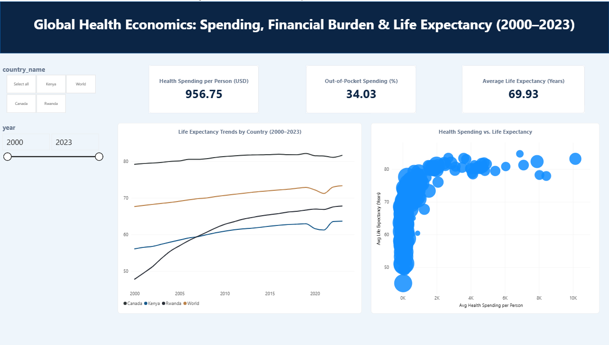

# Global Health Economics: Health Spending, Out-of-Pocket Burden & Life Expectancy (2000–2023)

## Overview
A Health Economics data analysis project exploring how healthcare spending per person and out-of-pocket household costs relate to life expectancy across 200+ countries and regions from 2000 to 2023.

## Questions Explored
1. How does higher healthcare spending per person affect life expectancy across low-, middle-, and high-income countries?
2. How have Kenya and Rwanda progressed in lowering out-of-pocket healthcare costs and increasing life expectancy since 2000 compared to Canada and the global average?

## Tools & Workflow
* **Data Source:** World Bank Open Health Data (Life Expectancy, Current Health Expenditure per Capita, and Out-of-Pocket Expenditure %).
* **Data Cleaning (Excel Power Query):** Unpivoted yearly columns into clean vertical tables (`country_code`, `year`, `value`), filtered data from 2000 onward, and removed blank reporting rows.
* **Database & SQL Analysis (MySQL):** Built a 3-table relational database (`health_economics_analysis.sql`), joined all metrics into a single view (`vw_health_economics_master`), calculated life-years achieved per $100 spent, and used `LAG()` window functions to track year-over-year changes.
* **Visualization (PowerBI):** Created an interactive dashboard with country and year filters, average KPI cards, longitudinal trend lines, and a spending vs. life expectancy scatter plot.

## Key Findings
* **Diminishing Returns on Spending:** Life expectancy rises rapidly when countries increase spending from very low levels (<$500 per person), but gains flatten out past ~$2,000 per person.
* **East African Progress:** From 2000 to 2021, Kenya increased health spending per person from $21.53 to $94.20 and reduced out-of-pocket spending from 47.33% to 22.65%, gaining over 5 years of life expectancy. Rwanda showed an even steeper life-expectancy rise after 2000.
* **2020–2021 Pandemic Dip:** Both high-income (Canada) and developing countries experienced a visible drop in life expectancy during 2020–2021 despite sharp increases in health expenditure.
